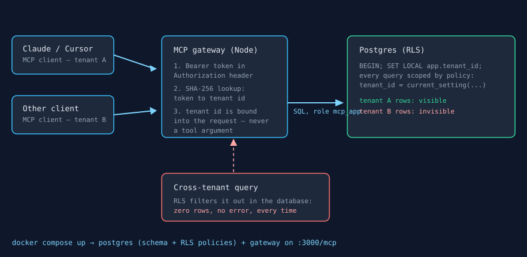

# Secure MCP server starter: bearer auth + Postgres RLS + Docker

A starter kit for running MCP (Model Context Protocol) servers that hold data for more than one user. Every request is authenticated with a bearer token, and every query is scoped by Postgres row-level security — so one tenant can never read another tenant's rows, no matter what the model is talked into.

```bash
git clone https://github.com/tjkilgore93-stack/hyperfya-zero-trust-mcp-kit.git
cd hyperfya-zero-trust-mcp-kit
cp .env.example .env   # change the passwords
docker compose up -d
docker compose exec server npm run issue-token -- my-tenant
```

Point any MCP client at `http://localhost:3000/mcp` with that token, and you have a working, authenticated, tenant-isolated MCP server.

## Why this exists

Most MCP servers that people attach to AI clients are effectively wide open:

- one shared database user, one shared set of rows
- API keys sitting in environment variables
- access control that depends on the model behaving itself

If you point an agent at a database-backed MCP server with multiple users, you are one prompt away from showing someone else's data. This kit replaces all of that with boring, correct defaults:

| Layer | Guarantee |
|---|---|
| Bearer auth | Tokens are SHA-256 hashed in the database. A leaked DB dump leaks no usable credentials. |
| Postgres RLS | Every query runs with `app.tenant_id` set, and every table policy compares against it. Isolation is enforced by the database, not by prompt engineering. |
| Fail-closed | `current_setting('app.tenant_id')` throws when unset, so a query outside the tenant-scoped path fails instead of leaking. |
| Minimal role | The app connects as `mcp_app` — grants on exactly two tables, no superuser, no `UPDATE`/`DELETE` on auth data. |
| Tenant binding | The tenant id is bound server-side into the request. Tools cannot accept a tenant id as an argument, so the model cannot request another tenant's rows. |

## Architecture



## What's inside

```
├── docker-compose.yml      # postgres + gateway, wired and healthy
├── db/
│   ├── init.sh             # creates the mcp_app role on first boot
│   └── schema.sql          # tables, grants, RLS policies
└── server/
    ├── src/
    │   ├── index.ts        # HTTP endpoint, bearer auth, per-request server
    │   ├── auth.ts         # token hashing + lookup
    │   ├── db.ts           # withTenant(): the only place RLS context is set
    │   ├── tools.ts        # example tenant-scoped tools
    │   └── scripts/issue-token.ts
    └── test/               # unit tests + full integration suite
```

The `notes` table and its four tools are examples. Replace them with your own tables and copy the pattern: a `tenant_id` column, the same RLS policy, and queries that only ever run inside `withTenant()`.

## Adding your own table

```sql
-- in db/schema.sql
CREATE TABLE documents (
  id         UUID PRIMARY KEY DEFAULT gen_random_uuid(),
  tenant_id  UUID NOT NULL REFERENCES tenants (id) ON DELETE CASCADE,
  title      TEXT NOT NULL,
  content    TEXT NOT NULL DEFAULT ''
);

GRANT SELECT, INSERT, UPDATE, DELETE ON documents TO mcp_app;

ALTER TABLE documents ENABLE ROW LEVEL SECURITY;
ALTER TABLE documents FORCE ROW LEVEL SECURITY;

CREATE POLICY tenant_isolation ON documents
  USING (tenant_id = current_setting('app.tenant_id')::uuid)
  WITH CHECK (tenant_id = current_setting('app.tenant_id')::uuid);
```

Then register a tool in `server/src/tools.ts` that queries it inside `withTenant(tenantId, ...)`. That's the whole pattern.

## Connecting a client

Any MCP client that speaks streamable HTTP works. Example for Claude Code or a generic client config:

```json
{
  "mcpServers": {
    "notes": {
      "type": "http",
      "url": "http://localhost:3000/mcp",
      "headers": { "Authorization": "Bearer hyf_YOUR_TOKEN" }
    }
  }
}
```

Raw request, for testing:

```bash
curl http://localhost:3000/mcp \
  -H "Authorization: Bearer hyf_YOUR_TOKEN" \
  -H "Content-Type: application/json" \
  -H "Accept: application/json, text/event-stream" \
  -d '{"jsonrpc":"2.0","id":1,"method":"tools/call",
       "params":{"name":"notes_create","arguments":{"title":"hello"}}}'
```

## Tests

The integration suite boots a real Postgres, applies the schema, and attacks the running server:

```bash
cd server
npm test                # unit: auth, token hashing
npm run test:integration # 10 checks against a real Postgres
```

Verified guarantees include: no token → 401, bogus token → 401, tenant B sees zero of tenant A's rows, tenant B cannot read or delete A's rows by id, and queries without tenant context fail closed. CI runs both suites on every push.

## Paid tier

The free core here is complete and MIT-licensed. A paid tier ($49–$149) adds production configs, Nginx/HAProxy setup, and a multi-tenant RLS guide — the parts you'd otherwise figure out the week something breaks.

## License

MIT — see [LICENSE](LICENSE).
